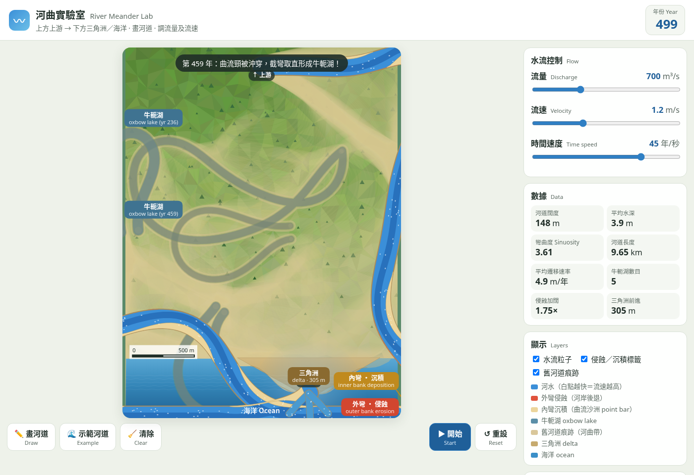

# 河曲實驗室 River Meander Lab

🌊 **網上版：** https://caritasfsc-anthony.github.io/river-meander-sim/

一個給中學地理課用的互動河曲模擬。地圖**上方是上游／高地，下方是河口、三角洲與海洋**。學生用滑鼠或手指由上畫到下，再調校**流量**和**流速**，觀察：

- **外彎侵蝕**（紅色）與 **內彎沉積**（沙色曲流沙洲）
- **河道因侵蝕而逐漸加闊**（流量決定基本寬度，侵蝕令寬度再增加，有軟上限）
- **河曲遷移**與 **截彎取直 → 牛軛湖**
- 河水最終流入下方的**海洋**

## 使用方法

1. 按「✏️ 畫河道」，由**上方（上游）畫到下方（河口）**（或按「🌊 示範河道」）
2. 調校 **流量**（m³/s）和 **流速**（m/s）
3. 按「▶ 開始」；「時間速度」控制每秒模擬多少年
4. 「↺ 重設」回到第 0 年；「🧹 清除」重新畫過

支援電腦、平板及手機（觸控）。

## 課堂建議

- 比較不同流量／流速下，「侵蝕加闊」倍數與第一個牛軛湖出現年份
- 觀察白色水流粒子：外彎較快、內彎較慢
- 留意舊河道痕跡如何形成河曲帶（meander belt）

## 模型說明

簡化中心線遷移模型（參考 Howard & Knutson, 1984）。河寬 = 流量基本寬度 × 侵蝕累積加闊（漸近軟上限約 2.6×）。此模擬只作教學示意。

## 技術

純 HTML / CSS / JavaScript（Canvas 2D）。執行 `node test/sim.test.js` 可測試模擬核心。
